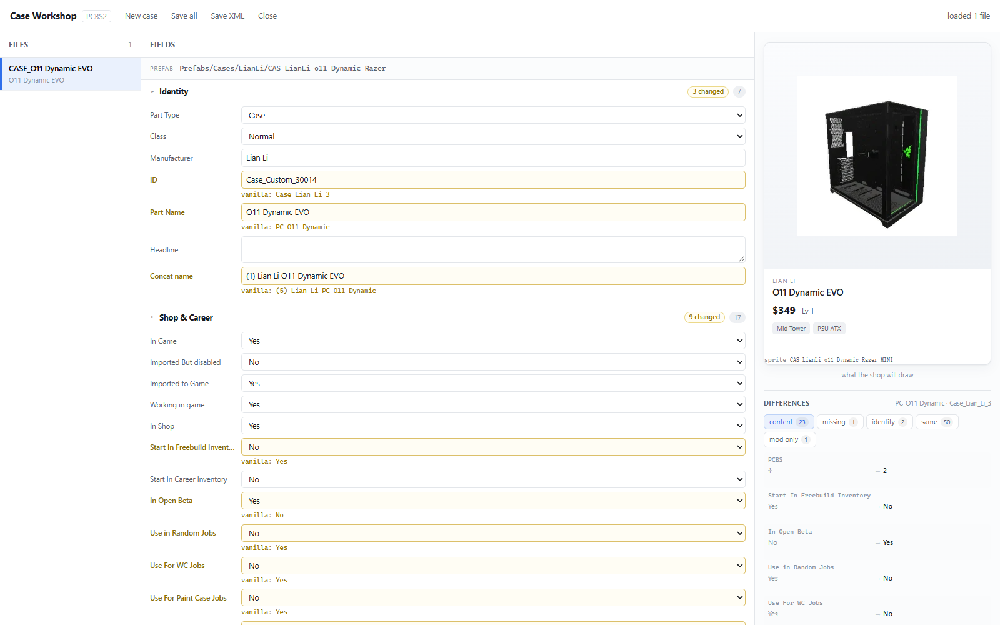
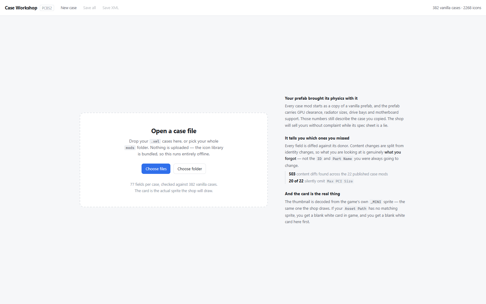

# PCBS2 Case Workshop

A browser-based editor for **PC Building Simulator 2** case mods.

Change a field, watch the shop card redraw. Compare your case against the vanilla
case its prefab came from, across all 77 fields.

No install, no `.exe`, no injected `.dll`. Open `web/index.html` and it runs.

**Try it without downloading anything:**
https://sefui12.github.io/pcbs2-case-workshop/web/index.html



The card on the right is not a mock-up: it is the same `_MINI` sprite the game's
shop draws, decoded from your own install. Left pane is your file. Middle pane is
all 77 fields, with the vanilla value shown underneath every field you changed.
Right is the card, the diff and the checks.

---

## Why this exists

The only other part editor for this game is **PCBS2 All in One Creator** by
marv17. It is a Windows `.exe` that needs three separate `.dll` mods installed
first, and it does not cover cases — it lists GPUs, CPUs, RAM, PSUs,
motherboards and storage.

Cases are the second-most-complex part type in the game (77 fields; GPUs have
92), and nobody had made a case editor. This tool does one part type, in a
browser, with no dependencies.

---

## What it actually does for you

**1. It shows you the card without launching the game.**
Editing a case normally means: edit XML → start game → load career → open shop
→ look → quit. A few minutes per round. Here the card redraws on every
keystroke, from the game's own sprite files.

**2. It finds the fields you forgot to change.** ← this is the real one

Almost every case mod is built by copying a vanilla prefab and editing it. The
prefab brings its *physics* with it: GPU clearance, radiator sizes, storage
slots, motherboard support. Those numbers still describe the donor case, not
yours, and the shop will happily sell a case whose spec sheet is a lie.

Across 22 published case mods this tool found **573 field-level differences**,
of which **503 are content** (as opposed to identity fields, which are supposed
to differ). Reading two XML files side by side will not find them.

Each row has a one-click **revert** to the vanilla value.

**3. It catches a column that mod files silently drop.**

`Max PCI Size` exists in all 382 vanilla cases (381 of them hold `3`). **20 of
the 22 published mods omit it entirely.** The game reads it as a default, so
nothing visibly breaks — which is precisely why nobody noticed.

---

## Running it



**Try it first, no download:** https://sefui12.github.io/pcbs2-case-workshop/web/index.html
— the hosted copy is byte-for-byte the same page, and still uploads nothing.

**Then open it.** Double-click `web/index.html`, or run `启动工坊.bat` on Windows
(which serves on `127.0.0.1:8770` for browsers that refuse `file://`).

Then drop `.xml` cases onto the page, or pick your whole `mods` folder.

Nothing is uploaded. There is no network code in this project — grep for
`fetch`, `XMLHttpRequest` or `http` in `web/js/` and you will find none.

### Keyboard

| Key | Action |
|---|---|
| `j` / `k`, or `↑` / `↓` | previous / next file |
| `1`–`5` | switch the differences tab |
| `Ctrl`/`Cmd`+`S` | save the current file |

---

## How the card is resolved

The shop card is **not** taken from `Icon Path`. It comes from `Asset Path`:

1. Take the last path segment of `Asset Path`
2. Look for a Sprite named `<segment>_MINI` in `PCBS2_Data/resources.assets`
3. Found → that artwork. Missing → **a blank white rectangle**

The lookup ignores case. This is encoded as `resolveIcon()` in
`web/js/pcbs2.js` and checked three ways:

- All **382** cases in the vanilla table resolve to a `_MINI` sprite.
- A 3697-file corpus of published mods produced no card from anything else.
- `node tools/verify_mods.js --self-test` re-checks the first claim against the
  shipped data, so the README cannot silently go stale.

There is deliberately **no fallback to the bare sprite** when the `_MINI`
variant is absent. The bare 512px sprites do exist and do contain real artwork,
but the game asks for `_MINI` specifically; falling back here would report a
blank card as healthy.

So the card on the right is not a mock-up. It is the actual `.webp` decoded
from the sprite the game will draw. If it renders here, it renders in game.

---

## The checks

Not a general linter. Every check answers *"will this case appear, look right,
and behave in the shop"*.

| Code | Level | Meaning |
|---|---|---|
| `E001` | error | `Asset Path` empty — the part has no prefab |
| `E003` | error | no `<segment>_MINI` sprite — blank card in the shop |
| `E004` | error | `Part Type` / `ID` / `In Game` missing or wrong |
| `E005` | error | `ID` already claimed by another loaded file |
| `E006` | warn | `Part Name` empty — the card has no title |
| `E007` | warn | `Asset Path` ends in `.prefab` |
| `E009` | warn | a field the vanilla donor has is missing entirely |
| `C001` | warn | `Restricted GPU length` exceeds `Max GPU length` |
| `C002` | warn | a motherboard-size flag is `1` but not listed in `Motherboard Size` |
| `C003` | warn | `SellPrice` above `Price` |
| `C004` | warn | `Model Supplied` blank |
| `I001` | note | no vanilla case uses this `Asset Path` (expected for a new prefab) |
| `I003` | note | blank level, or a level-1 case priced for day one |
| `I004` | note | `In Shop` is `No` |
| `I005` | note | file too incomplete for field comparison, so it was skipped |

`E009` only runs on files at least 90% complete. A hand-written stub with 8 of
77 fields would otherwise emit one warning per column and bury the findings
that matter — it gets a single `I005` instead.

---

## The differences panel

Not every mismatch is a bug, and the tabs say so:

| Tab | What it holds |
|---|---|
| **content** | Fields you probably forgot to update. The reverts live here. |
| **missing** | Vanilla columns your file does not have at all. |
| **identity** | `ID`, `Part Name`, `Asset Path` — these *should* differ. |
| **same** | Unchanged. |
| **mod only** | Columns mod files carry that vanilla does not (`Icon Path`). |

Splitting identity out matters: counting it as "changed" inflates the number by
70 across the 22-mod corpus and makes the real findings harder to see.

---

## Byte-exact round trip

Opening a file and saving it without edits must not change a single byte. This
sounds easy and is not:

- Retail files use **CRLF**, so the line ending is captured from the input.
- Some files carry a **UTF-8 BOM**, which is preserved.
- Some cells contain **trailing spaces** (`"S-ATX, "`). Untouched cells are
  written back from their original text; only fields you actually edit are
  re-encoded from the parsed value.

All 22 published case mods round-trip byte-identically. `tests/pcbs2.test.js`
keeps one regression test per item above.

---

## Rebuilding the data

`web/` ships with data extracted from a retail install. Regenerate it after a
game update:

```bash
pip install UnityPy Pillow

python tools/export_icons.py    --game "C:/Games/PCBS2"
python tools/extract_vanilla.py --game "C:/Games/PCBS2"
python tools/build_data_js.py
```

- **`export_icons.py`** writes `web/icons/*.webp` plus `index.json`. It keeps
  only `_MINI` sprites — the only ones the card uses. Measured on a retail
  install: 2268 sprites, ~42 s, ~10 MB. `--all-sprites` also exports the 512px
  set, which adds ~73 MB of artwork the shop never draws.
- **`extract_vanilla.py`** pulls the `Cases` TextAsset out of
  `sharedassets0.assets`. That table is positional and unannotated, so it is
  read by header index — 382 cases, 78 columns (1 blank + 77 named).
- **`build_data_js.py`** wraps both JSON blobs as `.js` files assigned to
  globals. This is what makes `file://` work: `fetch()` is blocked there, but a
  `<script src>` is not.

### One trap worth documenting

The vanilla table and mod XML **do not have the same columns**. Vanilla has
`Max PCI Size`; mod XML has `Icon Path`. Matching them by position rather than
by name silently misaligns 40+ fields and produces a wall of plausible-looking
nonsense. Everything in this project keys on the field name.

---

## Testing

```bash
node --test tests/pcbs2.test.js      # 51 unit tests, no dependencies
node tools/verify_mods.js --self-test   # re-checks this README's numbers
node tools/verify_mods.js --type=case "<mods folder>"   # against real files
```

`verify_mods.js` exits non-zero if any file fails to round-trip or any error
fires, so it works as a pre-commit gate. `--json` emits machine-readable output.

### Verified against

- 22 published case mods: **22/22 round-trip byte-identical**, 0 errors
- **503 content differences** found across them, all individually revertable
- `Max PCI Size` missing from **20 of 22**
- 2 of 22 use an `Asset Path` not in the vanilla table, so they have no donor —
  the tool says so rather than guessing

---

## Known gaps

- **No 3D preview.** The mesh lives in `catalog.bin` and external `CAB-*`
  bundles; nothing here touches them. The card shows the icon, not the model.
- **No prefab authoring.** You still copy a vanilla `Asset Path`. A genuinely
  new case shape needs new geometry, which is a different project.
- **Cases only.** Other part types will load and show their fields, but the
  groups, dropdowns and checks are tuned for cases. `Part Type` will report an
  error for a GPU file — that is a limitation, not a verdict.
- **The vanilla table is a snapshot.** It reflects the game build the data was
  extracted from.

---

## On the bundled artwork

`web/icons/*.webp` are decoded from the game's own sprite archive so the card
preview can be accurate offline. They are not a redistributable asset pack and
are not offered as one. If the rights holder objects, the correct response is
to delete that folder and have users run `tools/export_icons.py` against their
own install — the tool works identically either way.

See `NOTICES.md` for the full statement on artwork, trademarks and extracted
data.

---

## Licence

MIT for the code. See `LICENSE` and `NOTICES.md`.